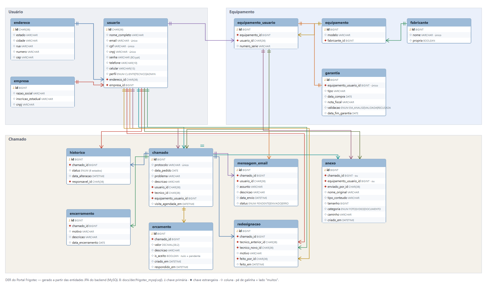

# DER do Portal Frigotec

Arquivos desta pasta:

- `DER_Portal_Frigotec.png`: diagrama gerado a partir das entidades JPA do back-end (14 tabelas, 3 grupos: Usuário, Equipamento, Chamado).
- `frigotec_mysql.sql`: o mesmo modelo em MySQL 8. Foi validado executando o script no H2 em modo MySQL, sem erros. Para usar o MySQL de verdade, basta apontar `spring.datasource.*` do back-end para ele.

## Decisão: o código segue o SDD, então o DER foi corrigido para espelhar o código

O DER anterior (feito no MySQL Workbench) tinha divergências com o SDD. Em vez de mexer no código, que cumpre as regras e tem testes, o DER foi refeito a partir dele. O mapeamento do que mudou:

| DER anterior | Agora | Motivo (SDD) |
|---|---|---|
| `equipamentoUsuario` sem PK própria (só `equipamento_id` e `usuario_uuid`) | PK `id` própria, `numero_serie` | O cliente pode ter 2 unidades do mesmo modelo; chamado e garantia precisam de um id para apontar (RN-EUS-02) |
| `garantia` com uuid, `status`, `dataOrigem`, `dataFim` | `garantia` 1 para 1 com `equipamento_usuario`: `tipo`, `data_compra`, `nota_fiscal`, `validacao` (EM_ANALISE, VALIDADA, RECUSADA), `data_fim_garantia` | Garantia é da unidade (RN-GAR-01); ativa ou vencida é calculada pela data, não gravada (RN-GAR-02); a equipe valida (RN-GAR-03) |
| Tabela `status` e `historico.status_id` | `historico.status` é ENUM de 6 estados | Os estados são fixos e em ordem (RN-CHM-10); a tabela não era usada |
| Tabela `grupoUsuario` | Coluna `usuario.perfil` (CLIENTE, TECNICO, ADMIN) | Uma única tabela de usuários; o técnico é um usuário com perfil (RN-USR-01) |
| `chamado` sem protocolo, técnico e visita | `protocolo` (único), `tecnico_id`, `visita_agendada_em` | RN-CHM-04, RN-CHM-12, RN-CHM-14 |
| `historico` só com data | `data_alteracao` DATETIME e `responsavel_id` | Ordem entre transições do mesmo dia e auditoria (RN-CHM-16) |
| `orcamento` com `valor` e `isAceito` | + `descricao`, `criado_em`, `respondido_em` | RN-ORC-03 |
| `mensagemEmail` | `chamado_id`, `usuario_id`, `status` (PENDENTE, ENVIADO, ERRO), `data_envio` | RN-ORC-08 e RN-NOT-03 |
| (não existia) | `redesignacao` | Auditoria da troca de técnico (RN-CHM-12) |
| `fabricante` só com nome | + `propria` (FrigoPro) | RN-EQP-03 |
| `logradouro` (com bairro e complemento) | `endereco` (estado, cidade, rua, número, CEP) | Segue o cadastro do wireframe |

Também foram removidas do código as entidades `Roles` e `Status` (tabelas sem uso, com dados de exemplo que nem batiam com os estados reais).

## Melhorias aplicadas depois da primeira versão

- **Campos obrigatórios no banco:** `chamado.usuario_id`, `chamado.equipamento_usuario_id` e `historico.chamado_id` agora são `NOT NULL`, como a regra de negócio exige.
- **Sem dados duplicados em `usuario`:** razão social e inscrição estadual ficam só em `empresa` (uma única fonte). O contrato da API não mudou: o `UsuarioDto` continua devolvendo esses campos, lidos da empresa.
- **Tabela `anexo`:** metadados dos arquivos enviados (fotos e vídeo do chamado, documentos da unidade), com a regra de que exatamente um entre `chamado_id` e `equipamento_usuario_id` é preenchido. O conteúdo fica em disco.
- **UUID como `CHAR(36)`:** `usuario.id` e `endereco.id` têm o mesmo tipo no H2 e no MySQL.
- **Banco persistente:** o perfil `mysql` (`application-mysql.properties`) e o `docker-compose.yml` sobem o MySQL com este mesmo modelo.
