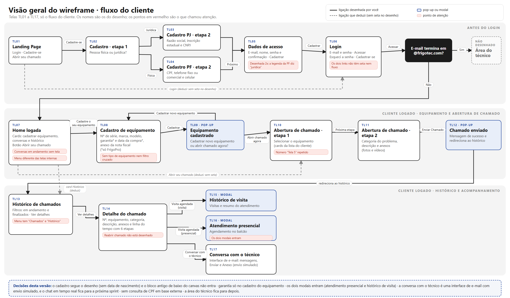

# Protótipo do Portal Frigotec

O protótipo tem três partes que se complementam: o **wireframe** (desenho das telas e das ligações), o **SDD de UI** (regras de cada tela) e o **front-end em React**, que é a versão final em alta resolução, integrada ao back-end.

## 1. Wireframe (Excalidraw)

Link do wireframe final: https://excalidraw.com/#room=c0415c94a667c46a178f,c0RQyluEj4vJmfPRW1aStA

Uma captura de cada tela está em [wireframes/](wireframes/):

| Fluxo | Telas |
|---|---|
| Cliente (17 telas) | TL01 Landing page · TL02 Cadastro: tipo de pessoa · TL03 Cadastro PJ · TL04 Cadastro PF · TL05 Dados de acesso · TL06 Login · TL07 Home logada · TL08 Cadastro de equipamento · TL09 Pop-up equipamento cadastrado · TL10 Abertura de chamado, etapa 1 · TL11 Abertura de chamado, etapa 2 · TL12 Pop-up chamado enviado · TL13 Histórico de chamados · TL14 Detalhe do chamado · TL15 Modal histórico de visita · TL16 Modal atendimento presencial · TL17 Conversa com o técnico |
| Técnico (4 telas) | TT01 Painel de chamados · TT02 Meus chamados · TT03 Detalhe do chamado (técnico) · TT04 Conversa com o cliente |

## 2. Fluxo de navegação

Resumo do fluxo do cliente: Landing → Cadastro (PF ou PJ) → Dados de acesso → Login → Home → Cadastro de equipamento → Abertura de chamado (2 etapas) → Chamado enviado → Histórico → Detalhe do chamado (com os modais de visita e a conversa). Quem entra com e-mail `@frigotec.com` vai para a área do técnico (TT01 a TT04).

## 3. Regras de cada tela

O SDD de UI descreve, por tela: componentes, estados, ações e ligações (`Portal-Frigotec-SDD-Especificacao-UI.md` e `Portal-Frigotec-SDD-Fluxo-Tecnico.md`, na pasta `PI/SDD-Figma` do grupo). Os tokens de design (cores, tipografia, espaçamento) e a biblioteca de componentes saíram dali e estão aplicados no front-end.

## 4. Versão final em alta resolução (React)

O front-end em `frontend/` implementa as telas do wireframe com o visual final, e todas as rotas abaixo conversam com o back-end Spring Boot:

| Tela | Rota | Endpoints usados |
|---|---|---|
| Landing | `/` | `GET /fabricantes` (carrossel de marcas) |
| Cadastro e login | `/cadastro`, `/login` | `POST /usuarios`, `POST /usuarios/login` |
| Meus equipamentos | `/equipamentos` | `GET /usuarios/{id}/equipamentos`, `DELETE /equipamentos/{id}` |
| Cadastro de equipamento | `/equipamentos/novo` | `GET /fabricantes`, `GET /fabricantes/{id}/equipamentos`, `POST /equipamentos/{id}` |
| Abertura de chamado | `/chamados/novo` | `POST /chamados` |
| Histórico e detalhe do chamado | `/chamados`, `/chamados/:protocolo` | `GET /chamados/usuarios/{id}`, `GET /chamados/{id}` |
| Painel do técnico (dashboard) | `/tecnico` | `GET /dashboard/tecnico` |
| Fila e detalhe do técnico | `/tecnico/chamados`, `/tecnico/chamados/:protocolo` | `GET /chamados`, `POST /chamados/{id}/atribuicao`, `PATCH /chamados/{id}/status`, `PATCH /chamados/{id}/visita`, `POST /chamados/{id}/encerramento` |

Para ver rodando: siga o README da raiz (back-end na porta 8080, front-end com `npm run dev` na 5173).

## 5. Fora do protótipo nesta versão

Conversa em tempo real com o técnico (a tela existe, o envio é simulado) e a área do técnico desenhada só em parte no wireframe: ambos foram decisões registradas no SDD.
